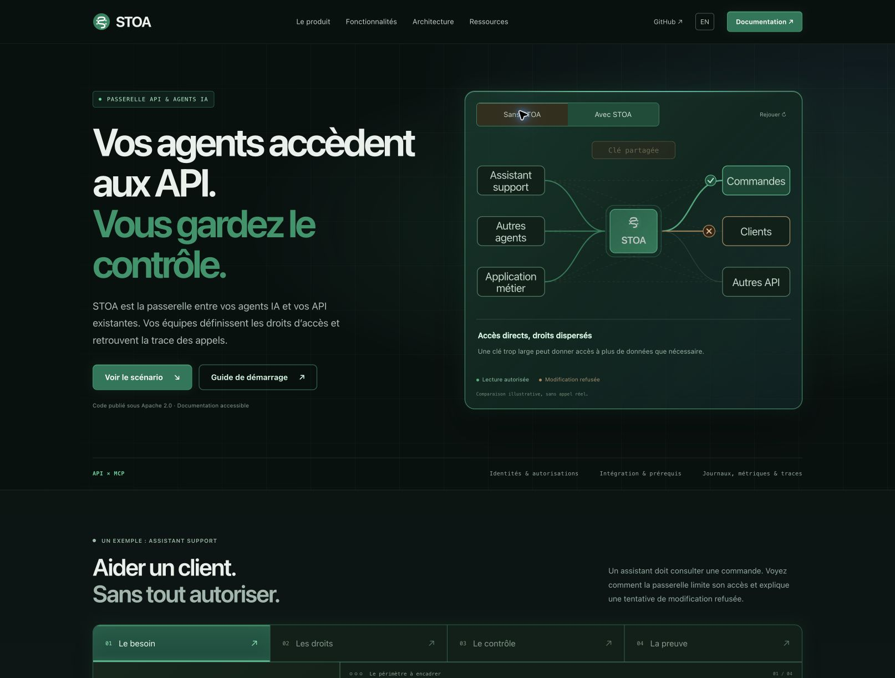
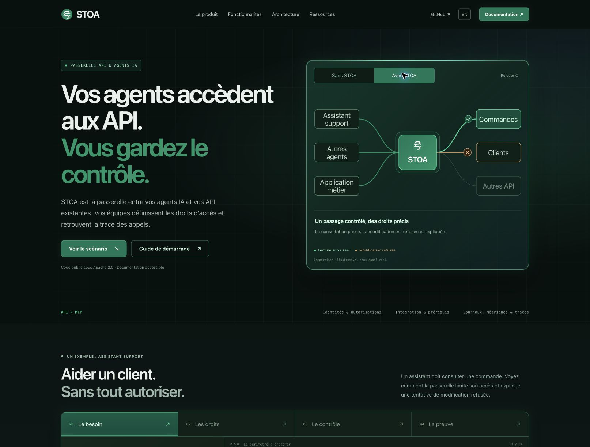
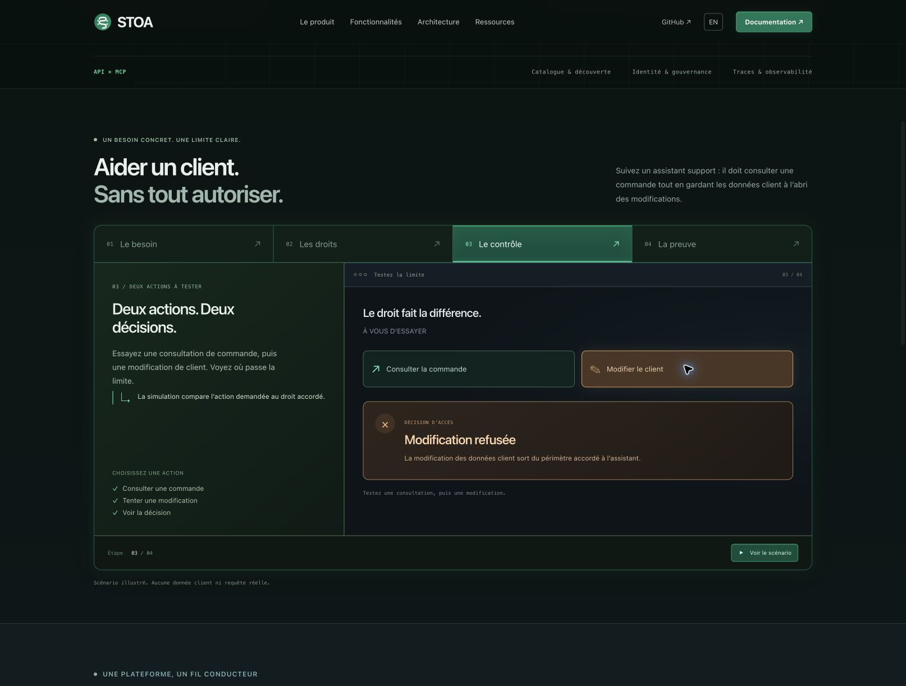
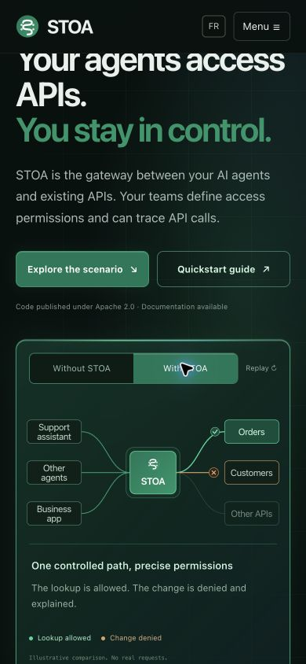

# Product home — a customer problem, a visible boundary

## Scope and decision

Christophe approved the proposed visual direction in the Site chat on 10 November 2026 (reply: “go”), then asked for luminous edges, a recognisable recall of the logo green, and a customer problem instead of a raw console screenshot. This change only affects the English and French `stoa-web` homepages. Product services, other repositories, public ports and credentials are outside scope.

## Immediate product explanation

The first screen identifies STOA as the controlled passage between agents and existing APIs, then explains its value with a before/after diagram. Without STOA, the illustrated access is scattered and overly broad; with STOA, it passes through a gateway with an allowed lookup and a denied change. The transition plays once when first visible, can be switched or replayed, and is disabled by reduced-motion preferences. It is an illustration rather than a claim about every alternative architecture.

## Customer scenario

A support assistant needs to look up an order, without being allowed to change customer records. Four selectable stages explain the need, the granted access, the access decision and the resulting trace. In the third stage, the visitor can try an allowed order lookup or a denied customer change. The fourth stage reflects that choice and explains who requested what.

This is a clearly labelled, local illustration. It neither fetches customer data nor calls a product endpoint or an AI provider. The console screenshots no longer load in the homepage; their historical assets are retained for existing references.

## Behaviour and accessibility

- Playback is user-initiated, lasts 18 seconds and ends after the fourth stage. Users can pause, replay or select a stage. Replay starts from the allowed example.
- Playback stops when the section leaves the viewport, the page becomes hidden, or a panel receives keyboard focus. Choosing an action also pauses it.
- Arrow keys, Home and End move between tabs. Buttons expose their selected state; results are announced politely.
- Reduced-motion users keep manual controls without timed playback or travelling particles. No scroll interception, video or new runtime dependency is introduced. The four-step customer scenario remains available below the comparison.
- Existing documentation, CAB, Labs and GitHub destinations are preserved.

## Brand colour

The exact emeralds in `public/favicon.svg` anchor the palette: `#047857` and `#059669`. Primary buttons use the darker shade with white text (contrast 5.48:1); large headline accents use the second shade (5.08:1 on the hero background). Lighter emerald tints make the boundaries visible. The small cyan and violet accents distinguish routing and access-control elements.

## Implementation and verification

`ProductScene.astro` renders the hero illustration. `ProductJourney.astro` renders the scenario. Text is bilingual in `product-journey.ts`. `product-home.ts` owns only local interactions; `product-motion.css` extends the retained layout.

The Node 24 / Astro 7 build generates all 11 routes. Browser checks cover the selectable stages, keyboard Home, finite playback, allowed and denied choices, choice propagation to the trace, before/after selection and first-view transition, FR/EN and 390px mobile layout without horizontal overflow. Reduced-motion handling was reviewed in code; OS preferences were not changed. No form or real request was submitted.

## Visual evidence

## Rollback

Revert the change commits through a PR and let the existing Vercel deployment follow main. No data migration or service setting needs rollback.
